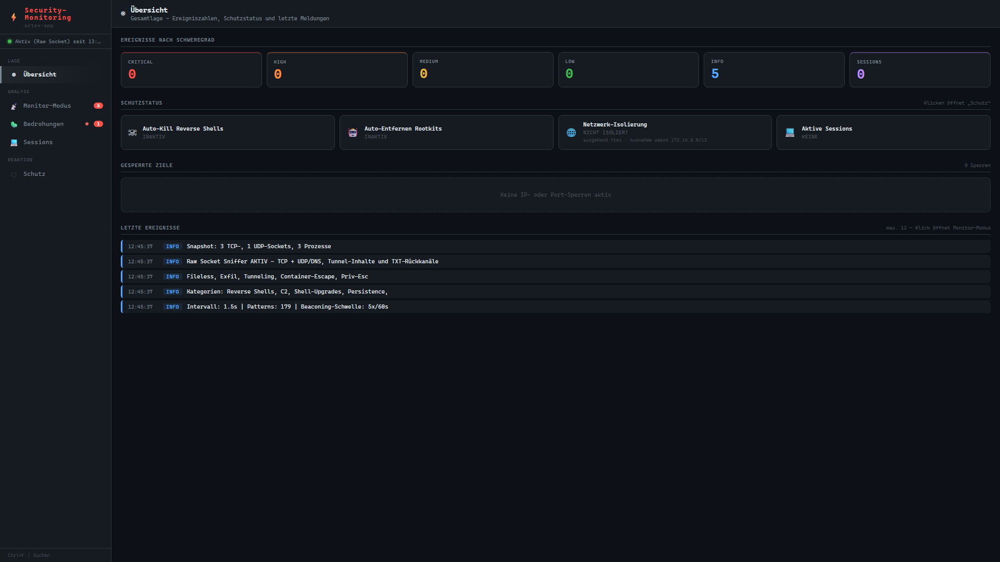
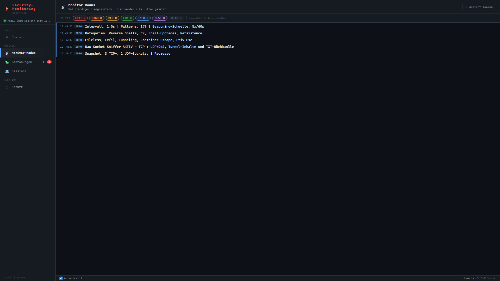
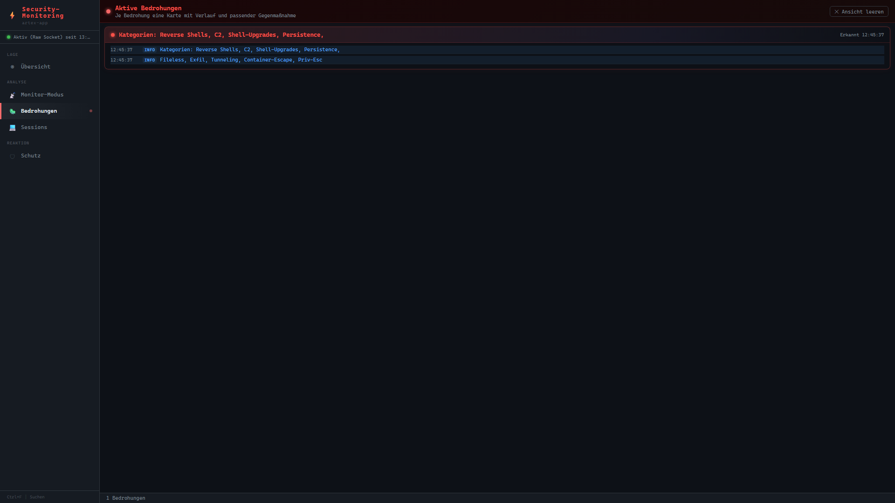
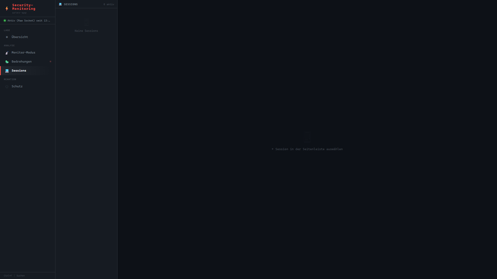
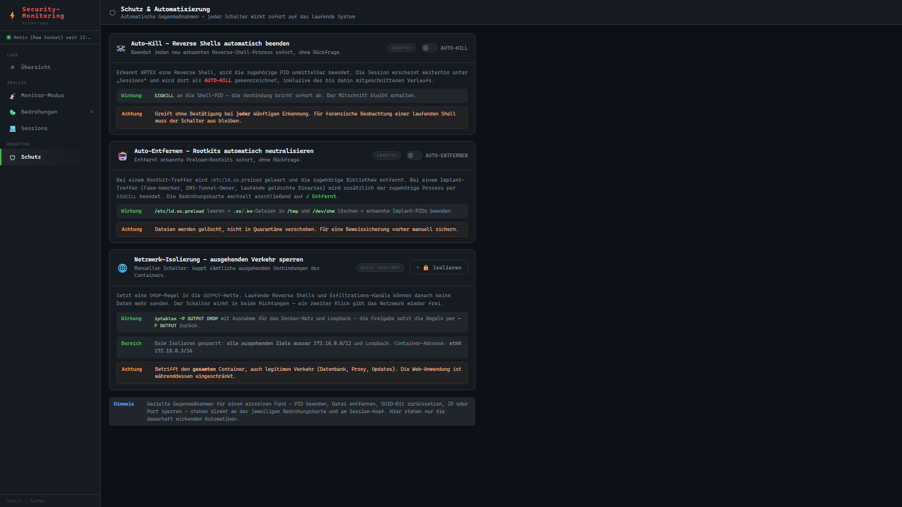

# ARTEX Security Monitor

A real-time security monitoring dashboard for Docker containers. Detects reverse shells, rootkits, process implants, DNS tunnels, and network anomalies — and can automatically neutralize them.

---

## Features

### Detection Modules

| Module | What it detects |
|--------|----------------|
| **Reverse Shells** | Outbound TCP connections from interactive shells (`bash`, `sh`, `nc`, `python`, `perl`) to external IPs |
| **Bind Shells** | Processes listening on unexpected TCP ports inside the container |
| **LD_PRELOAD Rootkit** | `/etc/ld.so.preload` entries pointing to malicious shared libraries |
| **Process Implants** | Fake kernel threads (kworker/kthread impersonators) running from deleted binaries |
| **DNS Tunneling** | High-entropy TXT/NULL queries, abnormal query rates, long domain names |
| **Credential Theft** | Access to `/etc/shadow`, `/etc/passwd`, SSH keys by unexpected processes |
| **Privilege Escalation** | SUID binary execution, `sudo` calls, container escape attempts |
| **File Integrity** | Modifications to critical system files and config |
| **Network Anomalies** | Port scans, unusual protocols, beaconing patterns |
| **Packet Inspection** | Raw-socket sniffer for deep packet analysis (requires `CAP_NET_RAW`) |

### LD_PRELOAD Rootkit Bypass

The monitor uses a **direct kernel `getdents64` syscall** (via `ctypes`) to enumerate `/proc` entries. This bypasses LD_PRELOAD hooks that intercept `libc readdir/getdents` — meaning hidden processes are still detected even when a rootkit is active.

```
syscall(SYS_GETDENTS64, fd, buf, bufsize)   # x86_64: 217 / aarch64: 61
```

Falls back to `os.listdir('/proc')` on unsupported architectures.

### Auto-Neutralize (Automatische Gegenmaßnahmen)

When enabled, the dashboard automatically:
- Removes LD_PRELOAD rootkit entries (after backup)
- Kills fake-kworker implant processes (SIGKILL)
- Optionally blocks IPs / kills connections via `iptables` + `conntrack`

---

## Architecture

```
Host (WSL / Linux)
├── start-dashboard.sh          # Launcher: sets up container deps, starts backend
├── artex-monitor-dashboard.py  # Backend: SSE bridge between container and browser
└── dashboard.html              # Frontend: real-time SPA (vanilla JS + SSE)

Docker Container (target)
└── /tmp/artex-monitor.py       # Monitor: runs as root, streams events to backend
```

The monitor script is automatically copied into the container by `start-dashboard.sh` on each start. Communication between monitor and dashboard uses a simple line-delimited JSON stream over `docker exec`.

---

## Screenshots

### Übersicht (Overview)


### Monitor-Modus (Event Stream)


### Bedrohungen (Active Threats)


### Sessions


### Schutz & Automatisierung (Protection)


---

## Requirements

**Host (where you run `start-dashboard.sh`):**
- Docker (user in `docker` group, or run as root)
- Python 3.6+
- `bash`, `ss`, `fuser` or `lsof`

**Container (auto-installed by setup script):**
- `python3`
- `iptables` (for IP/port blocking)
- `iproute2` (for `ss`)
- `conntrack` (optional, for connection teardown on block)
- `CAP_NET_RAW` capability (for packet sniffer; falls back to reduced mode without it)

---

## Usage

```bash
# Default: monitors 'artex-app' container on port 9999
bash start-dashboard.sh

# Monitor a specific container
bash start-dashboard.sh --container my-container

# Interactive container selection
bash start-dashboard.sh --manuell

# Monitor ALL running containers simultaneously (one dashboard per container)
bash start-dashboard.sh --all

# Help
bash start-dashboard.sh --help
```

Then open your browser at **http://localhost:9999** (or the port shown in the output).

### `--all` mode

Starts one dashboard instance per running container on sequential ports (9999, 10000, 10001, …). Each dashboard shows the container name in the title so you can identify them. Press Ctrl+C to stop all instances.

---

## Environment Variables

| Variable | Default | Description |
|----------|---------|-------------|
| `ARTEX_CONTAINER` | `artex-app` | Target container name |
| `ARTEX_PORT` | `9999` | Dashboard HTTP port |

---

## Dashboard Navigation

| Tab | Contents |
|-----|----------|
| **Übersicht** | Live summary: event counts by severity, protection status, last alerts |
| **Monitor-Modus** | Full real-time event log with severity badges and timestamps |
| **Bedrohungen** | Active threat banners with one-click countermeasure buttons |
| **Sessions** | Detected shell sessions with connection details and kill/block actions |
| **Schutz** | Auto-neutralize toggle, manual block/isolate controls, protection history |

**Keyboard shortcut:** `Ctrl+F` to search/filter events across all tabs.

---

## Security Notes

- The monitor runs as `root` inside the container to access `/proc`, raw sockets, and `iptables`
- The dashboard backend runs as the invoking user on the host (never root)
- Log files (`*.log`) are excluded from this repository — they may contain real IPs and session data
- The `payloads/` directory is not included — it contains test binaries used for the demo environment

---

## License

MIT
